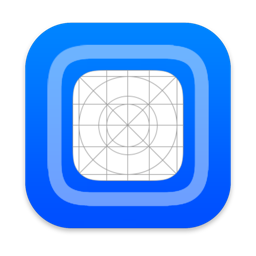
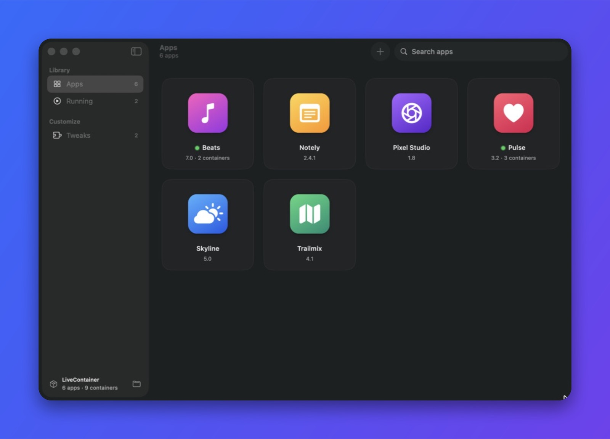
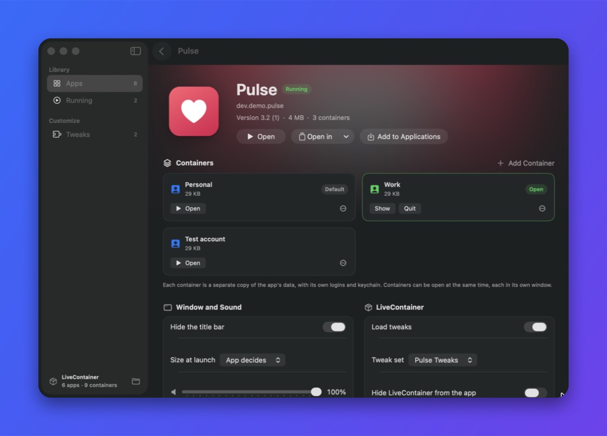
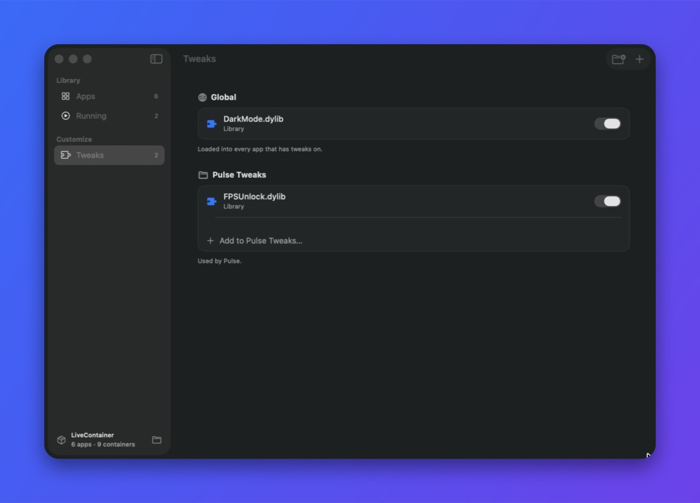

<div align="center">
  
  <h1>LiveContainer for Mac</h1>
  <p><b>Run iOS apps natively on Apple silicon Macs.</b><br>
  One library, as many separate data containers per app as you like, and every app in its own Mac window.</p>

  <p>
    
    
    
    <a href="https://github.com/LiveContainer/LiveContainer"></a>
  </p>
</div>

<p align="center"></p>

A Mac port of [LiveContainer](https://github.com/LiveContainer/LiveContainer), the iOS app launcher that runs apps without
installing them. Apple silicon Macs run iPhone code natively and macOS already ships the iOS frameworks, so there is no
emulation and no virtual machine: apps run at full speed.

> You bring your own **decrypted** `.ipa`. App Store downloads are FairPlay-encrypted and are refused.
> This project contains no apps and does not explain how to obtain them.

## Features

<table>
<tr>
<td width="50%" valign="top">

### 📦 Containers
Every app can have several data containers, each with its own logins, keychain, preferences and files: work and
personal accounts, or a clean profile for testing. Open them **side by side**, each in its own window.

### 🪟 Real Mac apps
Each app gets its own process, Dock icon and menu bar name. *Add to Applications* puts it in Launchpad and Spotlight.
Links and sign-in callbacks for the app's URL schemes open the right app.

### ⚡️ Fast installs and painless updates
Binaries are converted and signed in parallel, and copies are APFS clones: a 520 MB app installs in about 8 seconds.
Updating keeps containers, keychain and settings, and doesn't trigger new permission prompts.

</td>
<td width="50%" valign="top">

### 🧩 Tweaks
LiveContainer's TweakLoader with CydiaSubstrate. Global tweaks load into every app, and tweak sets load into the apps
that choose them. iOS tweaks are converted when you add them.

### 🎛 Per-app settings
Window size and full-height layout, a volume control for each app, arrow keys through swipe feeds, and a portrait
camera image that stays upright. From LiveContainer: hide LiveContainer from the app, report another iOS SDK version,
run in another language, and give each container its own identifierForVendor.

### ⌨️ Scriptable
Everything the app does is also available from `lcmac`, the command-line tool.

</td>
</tr>
</table>

<p align="center">
  
  
</p>

## Install

**Requirements:** a Mac with Apple silicon (M1 or later) and macOS 14 or later.

### Download

1. Download `LiveContainer-macOS.zip` from [Releases](../../releases/latest) and unzip it.
2. Move **LiveContainer** to your Applications folder.
3. The app is signed ad hoc, not with an Apple Developer ID. The first time, right-click it and choose **Open**, or run:
   ```bash
   xattr -dr com.apple.quarantine /Applications/LiveContainer.app
   ```

### Build from source

You only need the Xcode Command Line Tools (`xcode-select --install`); no Xcode project is involved.

```bash
git clone https://github.com/executed007/LiveContainer-macOS.git
cd LiveContainer-macOS
macOS/build.sh                       # builds and runs the unit tests
cp -R macOS/build/LiveContainer.app /Applications/
```

## Use

Drop an `.ipa` on the window, or click **+**. The app installs in a few seconds and opens.

- Click an app to see its page. Double-click it, or use the ▶︎ button, to open it.
- On an app's page, **Add Container** creates a fresh, empty copy of its data. Open any container from its card.
- Drop `.dylib` or `.framework` files on the window to add tweaks, then manage them on the **Tweaks** page.

From the command line (`LiveContainer.app/Contents/MacOS/lcmac`):

```bash
lcmac install App.ipa --run
lcmac container add App Work
lcmac run App --container Work      # alongside the default container
lcmac mac App windowSize phone
lcmac set App spoofSDKVersion 17.0
lcmac tweak add MyTweak.dylib
lcmac export App                    # put it in ~/Applications
lcmac help
```

## How it works

LiveContainer for Mac runs **LiveContainer's own runtime**, compiled for Mac Catalyst, with a small set of Mac-specific changes:

1. **Install:** every binary is thinned to arm64 and retargeted to Mac Catalyst (the approach PlayCover uses). The app's
   executable then gets LiveContainer's patch: it becomes a library the runtime can load, with TweakLoader injected.
2. **Launch:** each app has a tiny launcher app with its name, icon and URL schemes. The launcher loads LiveContainer's
   runtime, which points the app's home folder, preferences, keychain and app groups at the chosen container, swaps
   in the app's bundle, and jumps to its `main()`.
3. **Run:** the app is a normal Mac Catalyst process, with Mac window, volume, keyboard and camera adaptations.

The full write-up covers the upstream changes, the tests and the limits: **[macOS/README.md](macOS/README.md)**.

## Limits

- Apple silicon only, and decrypted apps only.
- App extensions (widgets, share extensions) and remote push notifications are not available.
- Apps that need iOS frameworks macOS does not ship for Catalyst will not launch.
- Apps are not sandboxed from each other, as in upstream LiveContainer.

## Credits

- **[LiveContainer](https://github.com/LiveContainer/LiveContainer)** by Duy Tran (khanhduytran0), hugeBlack and
  contributors: the runtime this fork is built on. The iOS project's README is kept as
  [README.upstream.md](README.upstream.md).
- **[PlayCover](https://github.com/PlayCover/PlayCover)**: the Mac Catalyst conversion method.
- **[Catalyst Runner](https://github.com/executed007/TikTokOnMac)**: Mac window, volume, keyboard and camera adaptations.
- [litehook](https://github.com/opa334/litehook) by opa334, and CydiaSubstrate as bundled by LiveContainer.

## License

[GNU Affero General Public License v3.0](LICENSE), as upstream LiveContainer.

LiveContainer for Mac is not affiliated with Apple or with the developers of any app you run in it. Apps you install
are for your own use on your own Mac.
